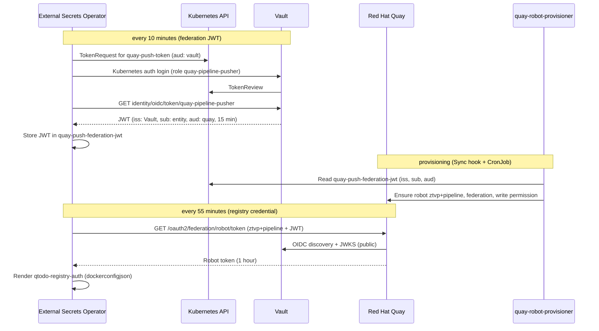

# Short-lived Quay robot tokens

This guide describes the optional **short-lived token generator** for the built-in Red Hat Quay registry (registry Option 1). When enabled, the secure supply chain pipeline and the `qtodo` application stop using the Quay administrator password. The [External Secrets Operator](https://external-secrets.io) (ESO) chains two generators instead:

1. A `VaultDynamicSecret` generator authenticates to Vault with a dedicated Kubernetes ServiceAccount and obtains a JWT signed by the **Vault identity OIDC provider** (15 minutes, audience `quay`).
2. A `Webhook` generator exchanges that JWT for a **Quay robot token that expires after one hour**, using Quay robot account federation.

The feature is **disabled by default**. It does not change the SPIFFE/ZTWIM based flows of the pattern (embedded OpenShift registry token refresher, RHTAS keyless signing, qtodo database credentials).

## Why short-lived tokens

### Previous method: static administrator password

With the built-in Quay registry, both registry Secrets are rendered from the same Vault KV entry (`secret/data/hub/infra/quay/quay-users`, property `quay-admin-password`):

* `qtodo-registry-auth` in the pipeline namespace, used by Tekton to push images, signatures and attestations.
* `qtodo-registry-auth` in the `qtodo` namespace, used by the kubelet to pull the application image.

That credential has several problems from a zero-trust point of view:

* **Excessive privilege**: it belongs to a Quay superuser. Every pipeline run and every node that pulls `qtodo` holds a credential that can administer the whole registry.
* **Long-lived**: it is valid until somebody rotates it manually. A leaked copy (logs, a compromised build step, a copied Secret) stays useful indefinitely.
* **No separation of duties**: the identity that pulls the image can also push, overwrite tags and delete repositories.
* **Weak attribution**: every action in the Quay audit log is attributed to the administrator.

### New method: federated robots and short-lived tokens

| Aspect            | Static admin password                   | Short-lived robot token                                                                |
| ----------------- | --------------------------------------- | -------------------------------------------------------------------------------------- |
| Lifetime          | Until manual rotation                   | Vault identity JWT: 15 minutes. Quay robot token: one hour. Renewed automatically      |
| Privilege (push)  | Quay superuser                          | Robot with `write` on the `qtodo` repository only                                      |
| Privilege (pull)  | Quay superuser                          | Robot with `read` on the `qtodo` repository only                                       |
| Stored in Vault   | Yes, consumed by every registry Secret  | No registry credential is stored; the admin password is only used to provision robots  |
| Proof of identity | Knowledge of a shared secret            | Kubernetes ServiceAccount verified by Vault, then a JWT signed by Vault                |
| Audit trail       | All actions logged as the administrator | Push and pull logged per robot (`ztvp+pipeline`, `ztvp+qtodo`), logins logged by Vault |
| Impact of a leak  | Full registry compromise, no expiry     | One repository, at most one hour                                                       |

### Zero-trust properties

* **Verify explicitly**: every token exchange is backed by a verified identity. Vault validates the ServiceAccount token with the Kubernetes TokenReview API (audience `vault`), and Quay validates the signature, issuer, subject and expiry of the Vault JWT before issuing a robot token.
* **Least privilege**: one robot per purpose, each scoped to one repository and one role. Each Vault identity can only request its own JWT (`identity/oidc/token/<name>`).
* **Assume breach**: no credential lives longer than one hour, and none of them can be used outside its scope. The federated ServiceAccounts are not mounted by any pod (`automountServiceAccountToken: false`), so only ESO can request tokens for them.
* **No new attack surface on the platform**: the Kubernetes API server is not exposed anonymously. Quay only downloads the Vault OIDC discovery document and public signing keys, which Vault serves without authentication by design, through the Vault route that already exists.

### Why not the ESO `QuayAccessToken` generator

ESO also provides a `QuayAccessToken` generator that sends a Kubernetes ServiceAccount token straight to Quay. Quay then has to download the discovery document and JWKS of the cluster ServiceAccount issuer. On a standard OpenShift cluster that issuer is `https://kubernetes.default.svc`: the JWKS endpoint requires authentication and is signed by internal API server CAs. Making it work would mean granting `system:unauthenticated` access to the API server discovery endpoints, which is not acceptable from a zero-trust point of view. Using Vault as the token issuer keeps the cluster issuer private and works on every OpenShift cluster.

## How it works



The `qtodo` pull secret follows the same flow with the `quay-pull-token` ServiceAccount, the `quay-qtodo-puller` Vault identity and the `ztvp+qtodo` robot (role `read`).

### Components

| Where                  | Resource                                                           | Purpose                                                                                                   |
| ---------------------- | ------------------------------------------------------------------ | --------------------------------------------------------------------------------------------------------- |
| Vault (imperative job) | Identity OIDC issuer, key `quay-federation`                        | Signs the identity JWTs; issuer is the Vault route                                                        |
| Vault (imperative job) | `quay-pipeline-pusher`, `quay-qtodo-puller`                        | Per identity: Kubernetes auth role, identity OIDC role and policy limited to `identity/oidc/token/<name>` |
| `supply-chain` chart   | `quay-push-token` ServiceAccount                                   | Identity of the push robot. No pod runs with it                                                           |
| `supply-chain` chart   | `pipeline-quay-federation-jwt` VaultDynamicSecret                  | Requests the Vault identity JWT; stored by the `quay-push-federation-jwt` ExternalSecret                  |
| `supply-chain` chart   | `pipeline-quay-token` Webhook                                      | Exchanges the JWT for a `ztvp+pipeline` robot token                                                       |
| `supply-chain` chart   | `qtodo-registry-auth` ExternalSecret                               | Renders the push credential from the Webhook generator instead of Vault KV                                |
| `supply-chain` chart   | `quay-robot-provisioner` CronJob and `-seed` Sync hook Job         | Creates the robots, their federation and repository permissions. Only consumer of the Quay admin password |
| `qtodo` chart          | `quay-pull-token`, `qtodo-quay-federation-jwt`, `qtodo-quay-token` | Same chain for the read-only pull secret                                                                  |

The provisioner learns the federation issuer, subject (the Vault entity of each identity) and audience by decoding the identity JWT that ESO stores, so the Quay federation always matches the tokens Quay receives. It only has `get` on those two Secrets.

## Prerequisites

1. **Red Hat Quay 3.13 or later**. Robot account federation was introduced in Quay 3.13 (the pattern installs the default channel of the Quay operator). Federation is only available for robots that belong to an organization; the pattern uses the organization of `global.registry.repository` (`ztvp`).
2. **Registry Option 1 is configured**: `global.registry` points to the built-in Quay, and `quayConfig` in `overrides/values-quay.yaml` creates the `ztvp` organization. The Quay admin password stays in Vault (`secret/data/hub/infra/quay/quay-users`) because the provisioner needs it to manage the robots.
3. **Quay trusts the ingress CA**, so it can download the Vault OIDC discovery document through the Vault route. The `ztvp-certificates` application adds the ingress CA to the cluster trusted CA bundle (`proxyCA.enabled`, default `true`), and the Quay operator injects that bundle into the Quay pods.
4. **ESO generators**: the Red Hat build of the External Secrets Operator (`stable-v1`) ships the `VaultDynamicSecret` and `Webhook` generators.

## Enabling the feature

### With `gen-feature-variants.py` (recommended)

Add the `quay-token-generator` feature to the supply chain with the built-in Quay registry. The feature requires `--registry-option 1`; other registry options are rejected:

```shell
python3 scripts/gen-feature-variants.py \
    --base values-hub.yaml \
    --features supply-chain,quay-token-generator \
    --registry-option 1
```

Review the generated file (`/tmp/values-hub-supply-chain-quay-quay-token-generator.yaml` by default), copy it over `values-hub.yaml`, and deploy the pattern. It can be combined with other features, for example `--features supply-chain,protected-repos,quay-token-generator`. See [Feature Variant Generator](../scripts/gen-feature-variants.md#short-lived-quay-robot-tokens-quay-token-generator).

### Manually

Set `quayTokenGenerator.enabled` in the Option 1 `global.registry` block of `values-hub.yaml`:

```yaml
global:
  registry:
    enabled: true
    domain: quay-registry-quay-quay-enterprise.apps.{{ .Values.global.clusterDomain }}
    repository: ztvp/qtodo
    user: quay-admin
    vaultPath: "secret/data/hub/infra/quay/quay-users"
    passwordVaultKey: "quay-admin-password"
    quayTokenGenerator:
      enabled: true
```

### What the flag controls

`global.registry.quayTokenGenerator.enabled` is the only switch. It enables the feature in the `supply-chain` and `qtodo` charts and in the Vault imperative job. Do not rely on the chart-level flags alone (`quayTokenGenerator.enabled`, `app.images.main.registry.quayTokenGenerator.enabled`): the Vault job only reads the global flag.

The rest of the configuration is already in the base `values-hub.yaml` and does nothing while the flag is `false`. Keep it when you customize `values-hub.yaml`:

```yaml
clusterGroup:
  sharedValueFiles:
    - '/overrides/values-vault-quay-federation.yaml'
  imperative:
    jobs:
    - name: configure-vault-quay-federation
      playbook: ansible/configure-vault-quay-federation.yaml
      timeout: 900
```

### Configuration

Vault side, `overrides/values-vault-quay-federation.yaml` (`vault_quay_federation`):

| Parameter                                    | Default                                     | Description                                                      |
| -------------------------------------------- | ------------------------------------------- | ---------------------------------------------------------------- |
| `issuer`                                     | `https://vault-vault.<hubClusterDomain>`    | Vault identity token issuer (must be reachable by Quay)          |
| `key.rotationPeriod` / `key.verificationTTL` | `86400` / `86400`                           | Signing key rotation and verification window (seconds)           |
| `clientId`                                   | `quay`                                      | Audience (`aud`) of the identity tokens                          |
| `tokenTTL`                                   | `900`                                       | Lifetime of the identity tokens (seconds)                        |
| `authMount` / `authAudience`                 | `hub` / `vault`                             | Kubernetes auth mount and required ServiceAccount token audience |
| `authTokenTTL`                               | `300`                                       | Lifetime of the Vault token issued at login (seconds)            |
| `identities`                                 | `quay-pipeline-pusher`, `quay-qtodo-puller` | Name, ServiceAccount and namespace of each identity              |

Chart side, `supply-chain` (`quayTokenGenerator`) and `qtodo` (`app.images.main.registry.quayTokenGenerator`):

| Parameter                                  | Default                                                                          | Description                                                             |
| ------------------------------------------ | -------------------------------------------------------------------------------- | ----------------------------------------------------------------------- |
| `federationTokenRefreshInterval`           | `10m`                                                                            | How often ESO requests a new Vault identity JWT (lower than `tokenTTL`) |
| `refreshInterval`                          | `55m`                                                                            | How often ESO exchanges a new robot token (Quay tokens last one hour)   |
| `pusher.robot` / `robot`                   | `pipeline` / `qtodo`                                                             | Short name of the robot (`<org>+<robot>`)                               |
| `pusher.serviceAccount` / `serviceAccount` | `quay-push-token` / `quay-pull-token`                                            | ServiceAccount of the identity                                          |
| `pusher.vaultRole` / `vaultRole`           | `quay-pipeline-pusher` / `quay-qtodo-puller`                                     | Vault Kubernetes auth role and identity OIDC role                       |
| `pullers` (supply-chain only)              | `[{robot: qtodo, namespace: qtodo, federationSecret: quay-pull-federation-jwt}]` | Read-only robots provisioned for workloads                              |
| `provisioner.schedule` (supply-chain only) | `*/15 * * * *`                                                                   | Schedule of the provisioner CronJob                                     |

Identity names, ServiceAccounts and namespaces must be the same in the Vault configuration and in the charts.

### Limitations

* `app.seedImage.enabled` in `qtodo` is not supported together with the generator. The seed Job pushes with the qtodo pull secret, which now only holds a read-only robot token. The chart fails to render with an explicit message when both are enabled.
* Red Hat Quay 3.18 does not store the `audiences` of a robot federation, so Quay does not enforce the `quay` audience of the identity JWT; it validates the signature, issuer, subject and expiry. The audience is still bound at the Vault side (only the `quay-federation` key and roles issue it), and the provisioner logs a warning when Quay did not store it.
* The provisioner manages the federation of its robots. Federation entries added manually to `ztvp+pipeline` or `ztvp+qtodo` are replaced on the next run.
* Tekton reads the registry credential when each task starts. In the worst case a task starts with a token that expires in about 5 minutes (1h token lifetime minus the 55m `refreshInterval`). Lower `refreshInterval` (for example `30m`) if a single push task takes longer.
* The Vault configuration is applied by an imperative job that runs every 10 minutes, so the first token exchange can take a few minutes after Vault is unsealed. ESO retries automatically.

## Verification

1. Check the Vault configuration job:

   ```shell
   oc get jobs -n imperative --sort-by=.metadata.creationTimestamp | grep imperative-cronjob
   oc logs -n imperative job/<latest imperative-cronjob job> -c configure-vault-quay-federation
   oc exec -n vault vault-0 -- vault read identity/oidc/role/quay-pipeline-pusher
   ```

2. Check the identity JWTs:

   ```shell
   oc get externalsecret -n vp-gitops quay-push-federation-jwt
   oc get externalsecret -n qtodo quay-pull-federation-jwt
   oc get secret -n vp-gitops quay-push-federation-jwt -o jsonpath='{.data.token}' \
     | base64 -d | cut -d. -f2 | base64 -d 2>/dev/null | jq '{iss, sub, aud, exp}'
   ```

   The issuer must be `https://vault-vault.apps.<domain>/v1/identity/oidc` and the audience `quay`.

3. Check the provisioner:

   ```shell
   oc logs -n vp-gitops job/quay-robot-provisioner-seed
   ```

   A successful run ends with `Quay robots are up to date`. The Sync hook Job exits successfully with a warning if Vault or Quay are not ready yet, so it does not block the Argo CD sync; the CronJob completes the provisioning later. TLS verification errors always fail the Job.

4. Check the registry Secrets and confirm they contain robot credentials, not the administrator:

   ```shell
   oc get externalsecret -n vp-gitops qtodo-registry-auth
   oc get externalsecret -n qtodo qtodo-registry-auth

   oc get secret -n vp-gitops qtodo-registry-auth -o jsonpath='{.data.\.dockerconfigjson}' \
     | base64 -d | jq -r '.auths[].auth' | base64 -d | cut -d: -f1
   # ztvp+pipeline

   oc get secret -n qtodo qtodo-registry-auth -o jsonpath='{.data.\.dockerconfigjson}' \
     | base64 -d | jq -r '.auths[].auth' | base64 -d | cut -d: -f1
   # ztvp+qtodo
   ```

5. In the Quay UI, open **ztvp** > **Robot Accounts** and check the federation and repository permissions of both robots. Pushes from the pipeline appear in the repository usage logs as `ztvp+pipeline`.

## Troubleshooting

| Symptom                                                                        | Likely cause                                                                                                                |
| ------------------------------------------------------------------------------ | --------------------------------------------------------------------------------------------------------------------------- |
| Federation JWT ExternalSecret: `permission denied` / `invalid role name`       | The imperative job has not configured Vault yet, or the identity names/ServiceAccounts differ from the chart values         |
| Federation JWT ExternalSecret: `no entity associated with the request's token` | Vault login did not create an entity; check the Kubernetes auth role (`vault read auth/hub/role/<name>`)                    |
| Registry ExternalSecret: HTTP `401` from `/oauth2/federation/robot/token`      | Robot not federated yet (provisioner pending), or Quay cannot download the Vault OIDC discovery document (ingress CA trust) |
| Registry ExternalSecret: `secret does not contain needed label`                | The federation JWT Secret lacks `external-secrets.io/type: webhook`                                                         |
| Provisioner loops on `identity JWT secret ... not available`                   | The federation JWT ExternalSecret has not synced yet (see the first rows)                                                   |
| Provisioner loops on `organization 'ztvp' not found yet`                       | The `quay-registry` application has not created the organization (`quayConfig.organizations`)                               |
| Provisioner fails with `admin sign-in failed`                                  | Wrong admin user/password in `global.registry.user` or Vault                                                                |
| Pipeline push fails with `unauthorized`                                        | Robot lacks `write` on the repository; re-run the provisioner (`oc create job --from=cronjob/quay-robot-provisioner ...`)   |

## References

* [External Secrets Operator: VaultDynamicSecret generator](https://external-secrets.io/latest/api/generator/vault/)
* [External Secrets Operator: Webhook generator](https://external-secrets.io/latest/api/generator/webhook/)
* [Vault identity tokens (OIDC provider)](https://developer.hashicorp.com/vault/docs/secrets/identity/identity-token)
* [Red Hat Quay: keyless authentication with robot accounts](https://docs.redhat.com/en/documentation/red_hat_quay/3/html/manage_red_hat_quay/keyless-authentication-robot-accounts)
* [How short-lived credentials in Quay improve security](https://developers.redhat.com/articles/2025/04/17/how-short-lived-credentials-quay-improve-security)
